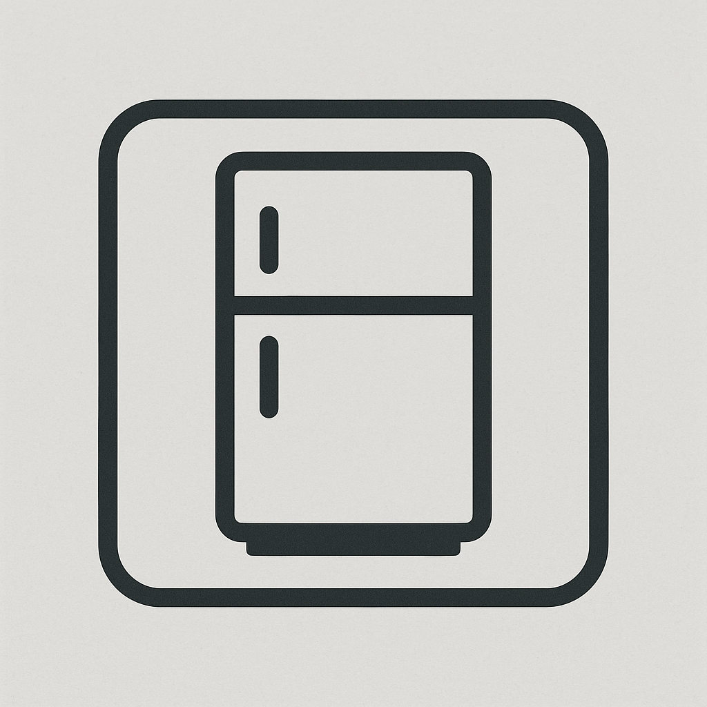

  

###

  

###

  

###

<h1 data-importer="text" align="center">OpenSmartFridge</h1>

###

<h3 data-importer="text" align="left">Über OpenSmartFridge</h3>

###

- simpel - schnell - lightweight

###

<h3 data-importer="text" align="left">Sprachen und Tools</h3>

###

  
  
  
  
  
  
  
  
  
  
  

###

<h3 data-importer="text" align="left">Stats :</h3>

###

  

###
